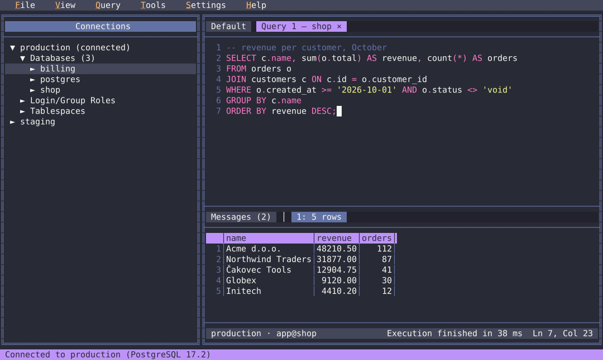
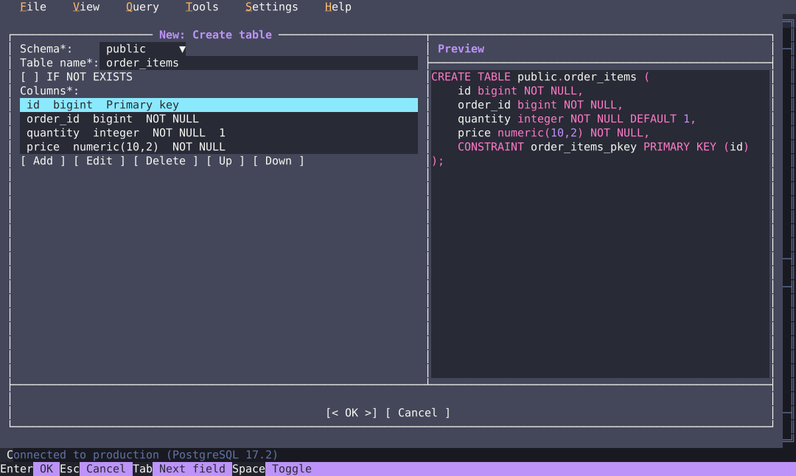
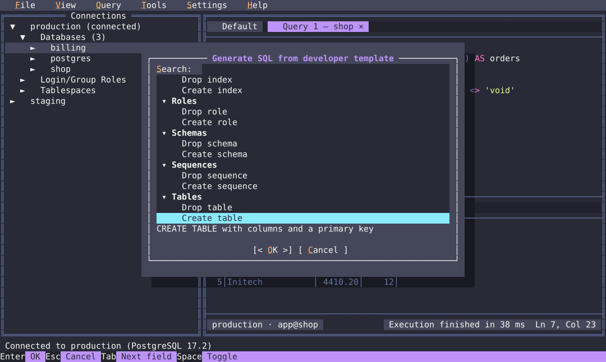
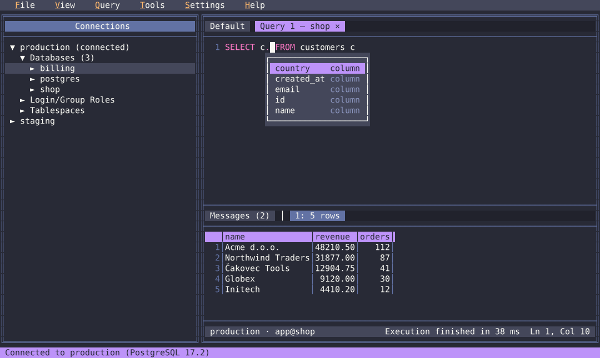
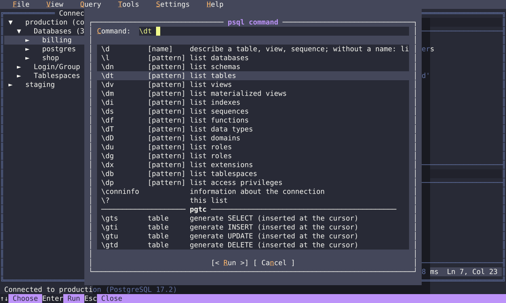
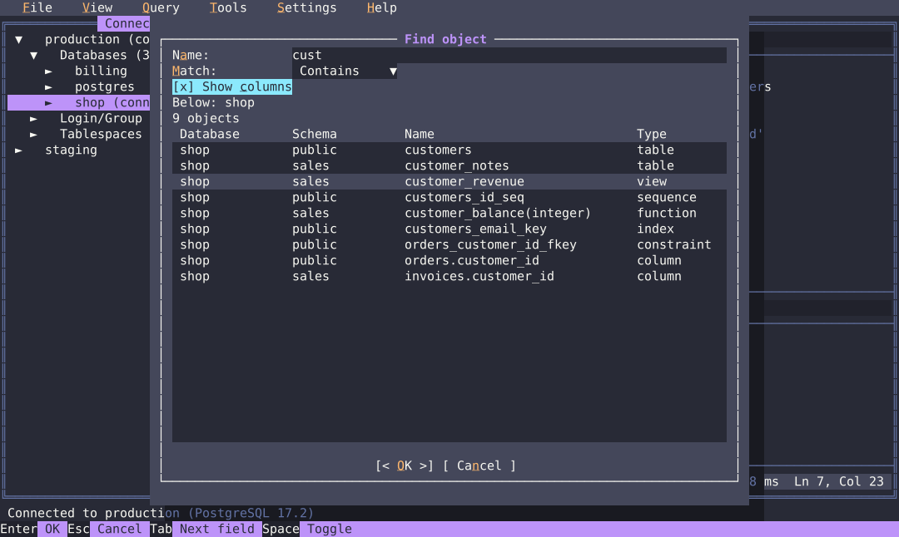
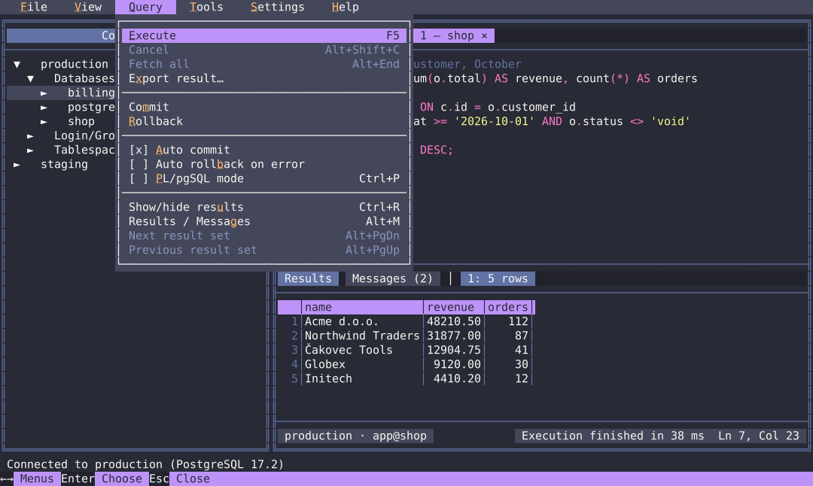

# pgtc — Postgres terminal commander

A PostgreSQL administration and query tool that runs entirely in the terminal —
locally or over SSH, on Linux, Windows and macOS. It looks and feels like
[Midnight Commander](https://midnight-commander.org/): an object tree on the left,
tabs with SQL on the right, function keys, menus and dialogs.



## Features

- **Object browser** — servers, databases, schemas, tables, columns, indexes, views,
  functions, triggers, roles, … with the SQL definition of the selected object.
- **SQL editor** — fast with very large scripts, syntax highlighting, find / replace,
  undo / redo, clipboard that works over SSH (OSC 52).
- **Autocomplete** — tables, columns (also after an alias), functions and keywords,
  read from the connected database.
- **Query execution** — streamed results in a grid, several result sets, messages and
  notices, cancel, transactions, PL/pgSQL mode.
- **psql-style commands** (`F4`) — psql's `\dt`, `\d table`, `\df`, `\du`, … typed without the
  backslash (`dt`, `d table`, …), plus pgtc's own `gts` / `gti` / `gtu` / `gtd` to generate SELECT / INSERT / UPDATE / DELETE for a
  table.
- **Export** results to CSV, JSON or XML — the whole result, streamed to the file.
- **Developer templates** — fill in a short form, get ready-to-run SQL (CREATE
  TABLE, FUNCTION, INDEX, …); add your own templates as files.
- **Database definition** export to a file and **sync** of another database to it
  (only the needed CREATE / ALTER statements, for review before running).
- **Colour schemes** (Classic, Dark, Light, Terminal default, Tokyo Night, Dracula and
  your own), configurable keys, optional Nerd Font icons.

| Developer template: Create table | Developer templates (`F7`) |
|---|---|
|  |  |

| Autocomplete | psql commands (`F4`) |
|---|---|
|  |  |

| Find object in the tree (`Ctrl+F`) | Query menu |
|---|---|
|  |  |

*Screenshots: the Dracula colour scheme, drawn by pgtc's own renderer with sample data.*

## Building

pgtc is distributed as source. You need [Rust](https://rustup.rs/) (the toolchain
version is pinned in `rust-toolchain.toml`); no C compiler, no libpq.

```sh
git clone https://github.com/pokrad/pgtc.git
cd pgtc
cargo build --release
# the program: target/release/pgtc  (pgtc.exe on Windows)
```

or install it into `~/.cargo/bin`:

```sh
cargo install --path crates/pgtc
```

## Usage

```sh
pgtc                                   # start with the saved connections
pgtc -h db.example.com -U app shop     # psql-style connection options
pgtc postgresql://app@localhost/shop   # or a connection URI
pgtc --setup                           # install the developer templates
pgtc --help
```

Passwords are read from (and optionally saved to) the standard PostgreSQL `.pgpass`
file; `PGHOST`, `PGUSER`, `PGPASSWORD` and the other libpq variables work as in psql.

| Key | Action |
|---|---|
| `F1` | keyboard shortcuts of the focused panel |
| `F2` | context menu |
| `F4` | psql-style commands |
| `F5` | execute the selection or the whole script |
| `F6` | switch panel |
| `F7` | generate SQL from a developer template |
| `F9` | menu |
| `F10` | quit |
| `Ctrl+N` | new query tab |
| `Ctrl+Space` / `Alt+/` | autocomplete |

`Esc` followed by a digit works as an F-key in terminals that do not pass F-keys
through. All keys can be changed in `keymap.toml` (Help → Keyboard shortcuts shows
where it is).

## Status

pgtc is in development towards its first alpha release. PostgreSQL 11 and newer are
supported.

## Licence

pgtc is released under the [PostgreSQL Licence](LICENSE). Catalog queries are adapted
from [pgAdmin 4](https://www.pgadmin.org/) (also under the PostgreSQL Licence); the
licences of all third-party code are in [THIRD_PARTY_LICENSES](THIRD_PARTY_LICENSES/)
and in the program under Help → Third-party licences.
