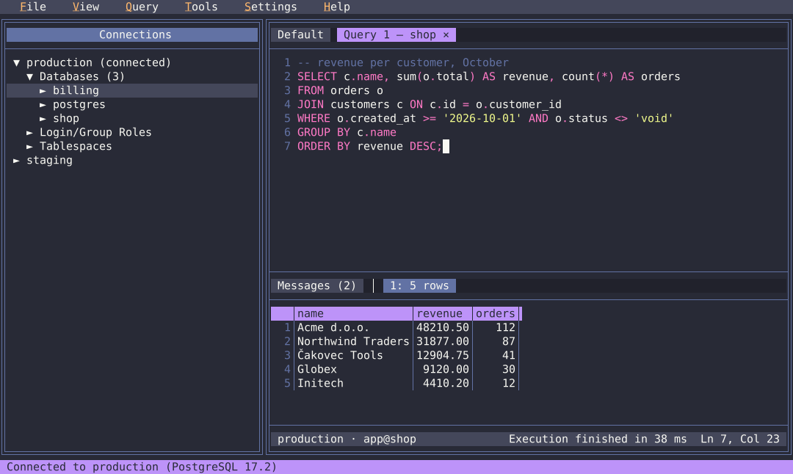
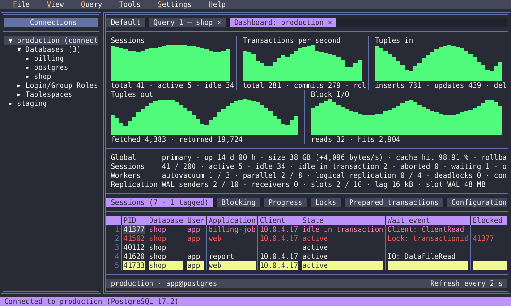
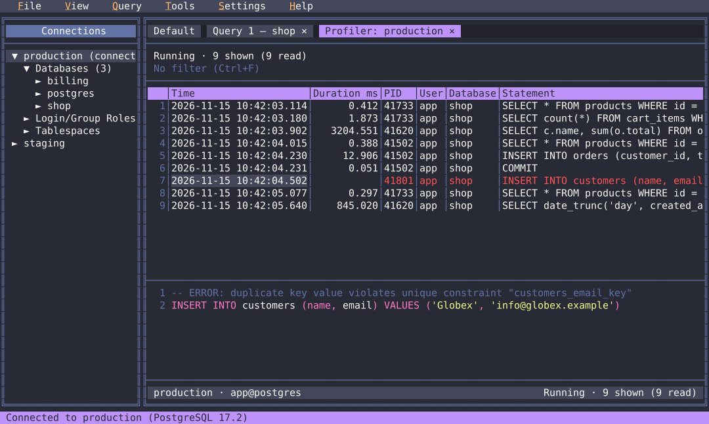
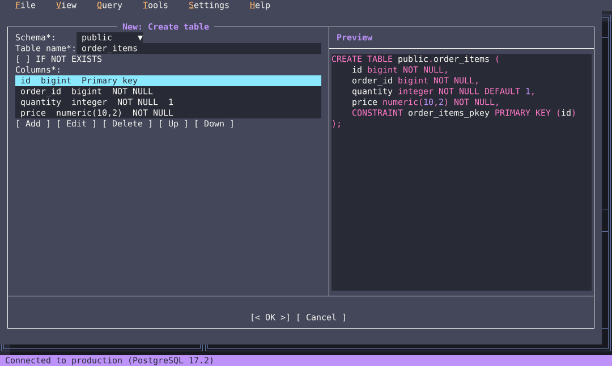
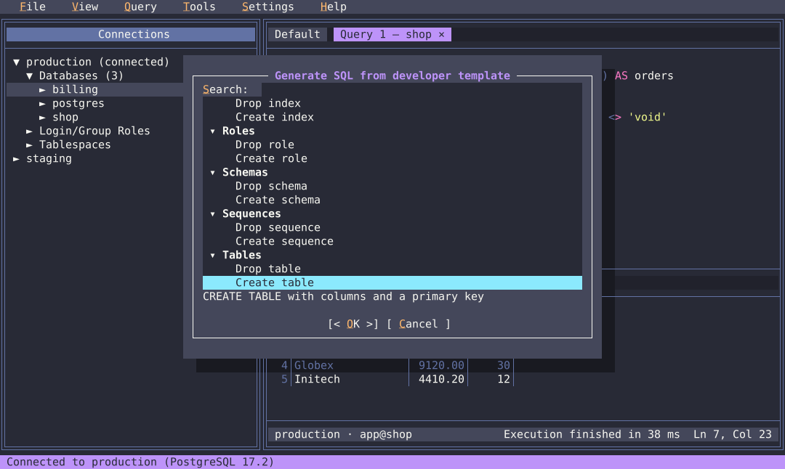
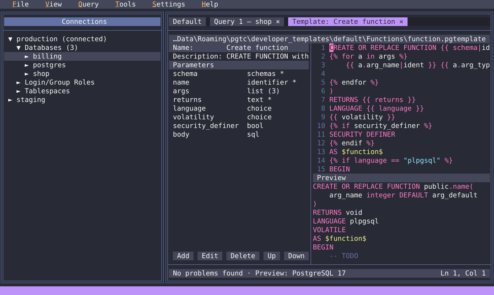
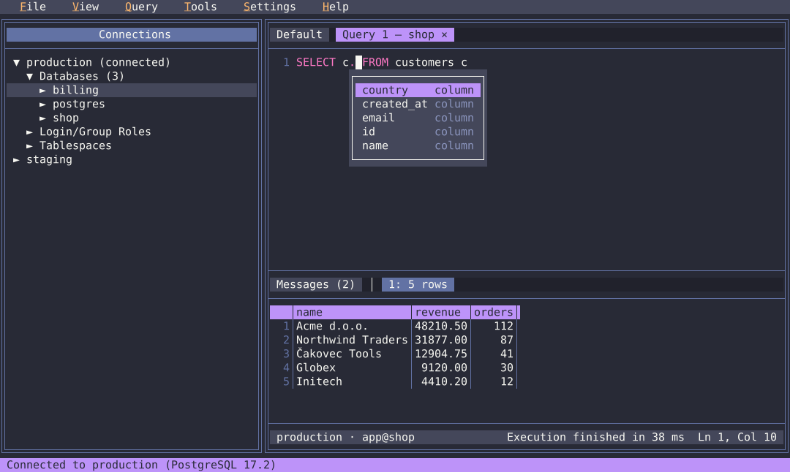
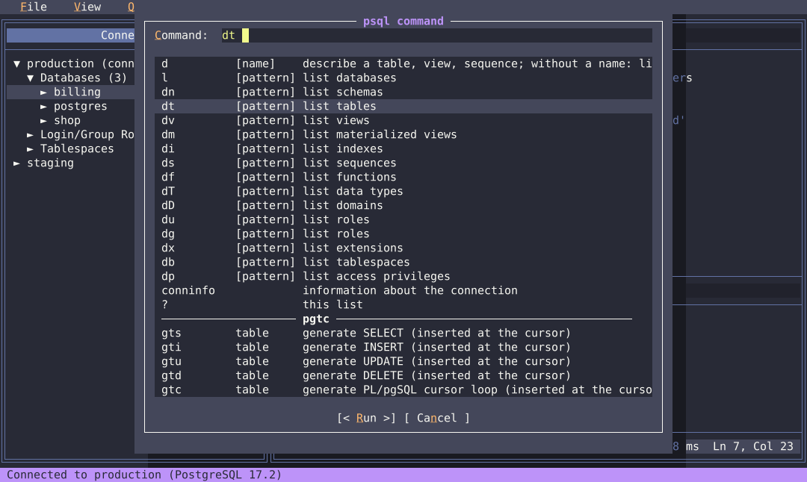
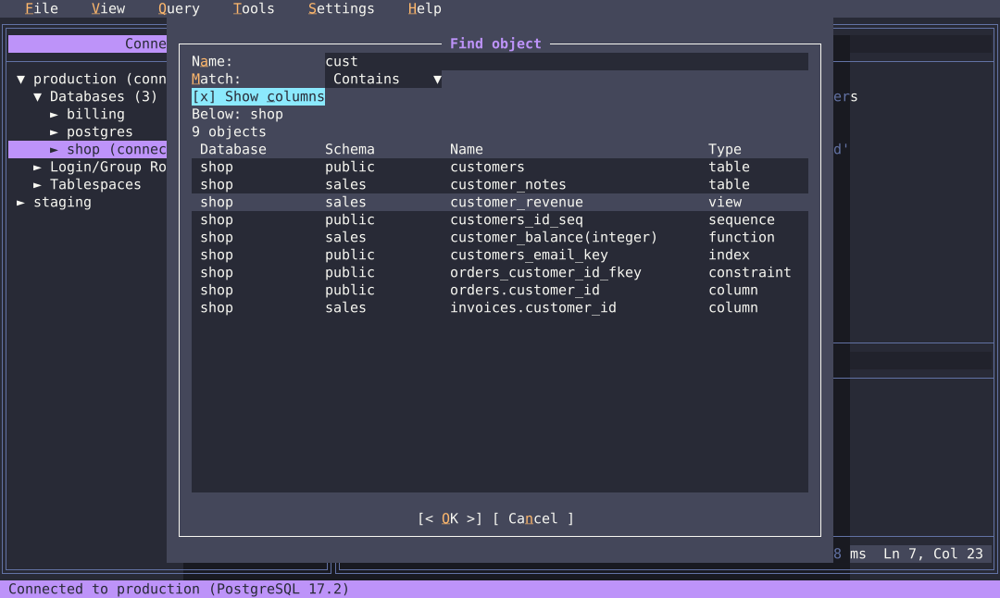
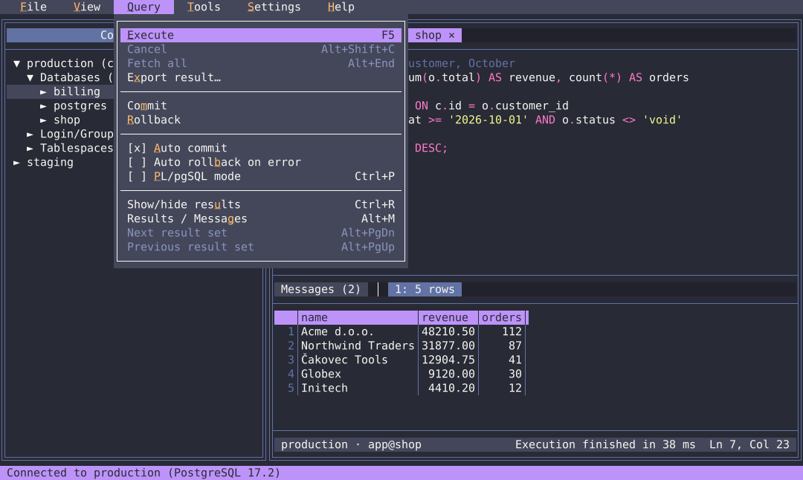

# pgtc — Postgres terminal commander

A PostgreSQL administration and query tool that runs entirely in the terminal —
locally or over SSH, on Linux, Windows and macOS. On a good day it looks and feels
like [Midnight Commander](https://midnight-commander.org/) and thinks like
[pgAdmin](https://www.pgadmin.org/). An object tree on the left, tabs with SQL on the
right, function keys, menus and dialogs.



## Features

- **Object tree** — servers, databases, schemas, relations, columns, indexes,
  constraints, routines, triggers, types, roles, tablespaces, … read lazily from the
  system catalogs, with the DDL of the selected object (`pg_get_*def()` and assembled
  `CREATE` statements).
- **SQL editor** — fast with very large scripts, syntax highlighting, find / replace,
  undo / redo, clipboard that works over SSH (OSC 52).
- **Autocomplete** — schemas, relations, columns (also through a `FROM` / `JOIN`
  alias), functions, types and keywords, read from the catalogs on the tab's own
  session, so it follows that session's `search_path`.
- **Query execution** — one session per query tab; the script is sent as one
  simple-query message. Results are streamed in batches (the rest stays on the
  server until fetched), one grid per result set; notices, command tags and errors
  with `DETAIL` / `HINT` and a jump to the error position; cancel request;
  auto commit / auto rollback with the session's transaction status shown;
  PL/pgSQL mode (the text runs as a `DO` block).
- **psql-style commands** (`F4`) — psql's `\dt`, `\d table`, `\df`, `\du`, … typed without the
  backslash (`dt`, `d table`, …), plus pgtc's own `gts` / `gti` / `gtu` / `gtd` to generate SELECT / INSERT / UPDATE / DELETE for a
  table, `gto` / `gtm` for an `INSERT … ON CONFLICT` upsert or a `MERGE`, `gtc` / `gtsi` for a
  PL/pgSQL cursor loop or a single-row `SELECT … INTO` variables, `gtrb` / `gtra` / `gtsb` / `gtsa` for a
  row or statement, before or after trigger with its function, and `gtv` for a view joining several tables on their foreign keys.
- **Server dashboard** (`Alt+D`) — live graphs from `pg_stat_database`, a summary of
  the cluster's health (backends, oldest transaction, the backend holding back the
  xmin horizon, replication lag and slots), `pg_stat_activity` with
  `pg_blocking_pids()`, the `pg_stat_progress_*` views (VACUUM, CREATE INDEX, …),
  `pg_locks`, prepared transactions; `pg_cancel_backend()` /
  `pg_terminate_backend()` for one or several backends.
- **SQL profiler** (`Alt+P`) — every statement the cluster executes, with its
  duration, bind parameters and errors, read from the server log (the logging
  settings are changed with `ALTER SYSTEM` for the run and put back afterwards).
- **Export** of a result set to CSV, JSON or XML — the whole result, not only the
  fetched rows, streamed to a client-side file.
- **Developer templates** — Jinja templates with typed parameters: fill in the
  generated form (choice lists come from the catalogs) and get the SQL (`CREATE
  TABLE`, `FUNCTION`, `INDEX`, …) at the cursor; per-server-version variants. Write
  your own in the **template editor** (parameter dialogs, helpers for the Jinja body,
  live preview, test in the real form).
- **Database definition** — export of a database's schema to a deterministic JSON
  file (diffable in version control) and **sync** of another database to it: a
  dependency-ordered script with only the needed `CREATE` / `ALTER` statements,
  opened in a query tab for review, never executed by pgtc itself.
- **Colour schemes** (Classic, Dark, Light, Terminal default, Tokyo Night, Dracula and
  your own), configurable keys.

| Server dashboard (`Alt+D`) | SQL profiler (`Alt+P`) |
|---|---|
|  |  |

| Developer template: Create table | Developer templates (`F7`) |
|---|---|
|  |  |

| Developer template editor (Tools → Developer templates…) |
|---|
|  |

| Autocomplete | psql commands (`F4`) |
|---|---|
|  |  |

| Find object in the tree (`Ctrl+F`) | Query menu |
|---|---|
|  |  |

*Screenshots: the Dracula colour scheme, drawn by pgtc's own renderer with sample data.*

## Building

pgtc is distributed as source. You need [Rust](https://rustup.rs/) (the toolchain
version is pinned in `rust-toolchain.toml`); no C compiler, no libpq.

```sh
git clone https://github.com/pokrad/pgtc.git
cd pgtc
cargo build --release
# the program: target/release/pgtc  (pgtc.exe on Windows)
```

or install it into `~/.cargo/bin`:

```sh
cargo install --path crates/pgtc
```

## Usage

```sh
pgtc                                   # start with the saved connections
pgtc -h db.example.com -U app shop     # psql-style connection options
pgtc postgresql://app@localhost/shop   # or a connection URI
pgtc --setup                           # install the developer templates
pgtc --help
```

Passwords are read from (and optionally saved to) the standard PostgreSQL password
file (`.pgpass`). The libpq environment variables `PGHOST`, `PGPORT`, `PGUSER`,
`PGDATABASE`, `PGPASSWORD`, `PGSSLMODE` and `PGSSLROOTCERT` are honoured; pgtc does
not link libpq, so the others are not read.

**Keys:** pgtc is used like Midnight Commander — `F9` opens the menu, and **`F1`
shows the keys that work right now** in the part of the window that has the focus
(object tree, query editor, results, a dialog, …), grouped by what they do.
Help → Keyboard shortcuts lists every key. All keys can be changed in `keymap.toml`
(Help → Keyboard shortcuts shows where it is).

**Help:** the full manual — every feature explained step by step, with screenshots —
is at <https://pokrad.github.io/pgtc/help/>. The same pages are in the source:
open `docs/help/index.html` in a browser (it works offline).

`Esc` followed by a digit works as an F-key in terminals that do not pass F-keys
through. Alt+arrows also work from PuTTY in its default setting (Alt sent as an `Esc`
prefix); in PuTTY 0.77+ the xterm style for arrow keys with modifiers
(Terminal → Keyboard) works as well.

## Status

pgtc is in development towards its first alpha release. PostgreSQL 11 and newer are
supported.

## Licence

pgtc is released under the [PostgreSQL Licence](LICENSE). Catalog queries are adapted
from [pgAdmin 4](https://www.pgadmin.org/) (also under the PostgreSQL Licence); the
licences of all third-party code are in [THIRD_PARTY_LICENSES](THIRD_PARTY_LICENSES/)
and in the program under Help → Third-party licences.
